# 常用材料验收要求

## 一、材料

### 1、焊接钢管

规范：《GB/T 3091-2025 低压流体输送用焊接钢管》

5.1.1 钢管按公称外径（D）和公称壁厚（t）交货。公称外径不大于 219.1 mm 的钢管（不含管端采用螺
纹或沟槽连接的钢管），其公称外径和公称壁厚及允许偏差应符合表 1 的规定。

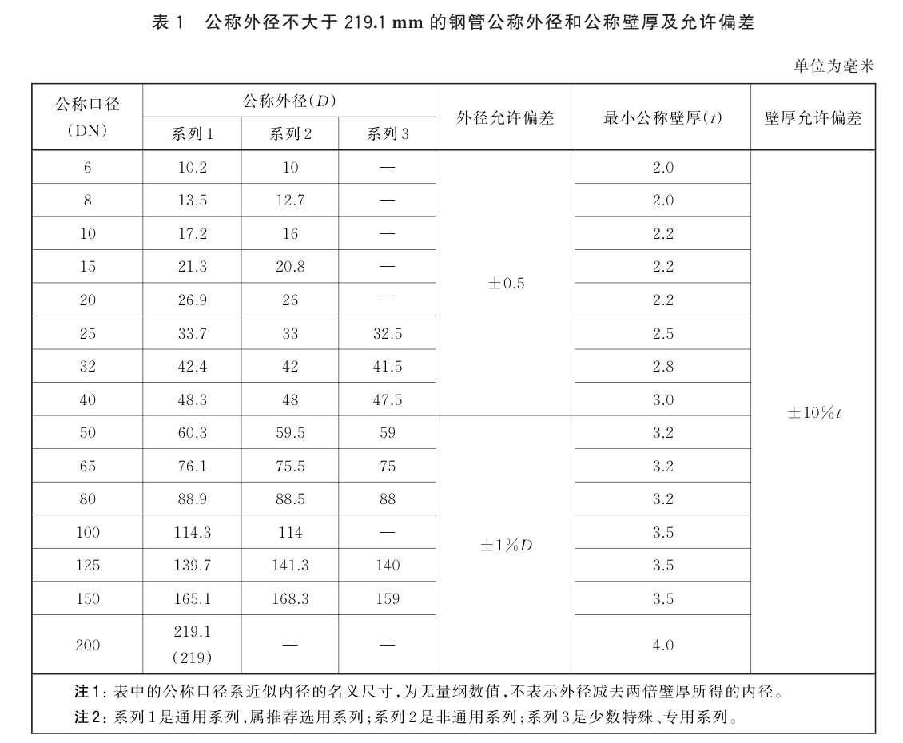

5.1.2 公称外径大于 219.1 mm 的钢管，其公称外径和公称壁厚应符合 GB/T 17395 的规定，公称外径
和公称壁厚的允许偏差应符合表 2 的规定。

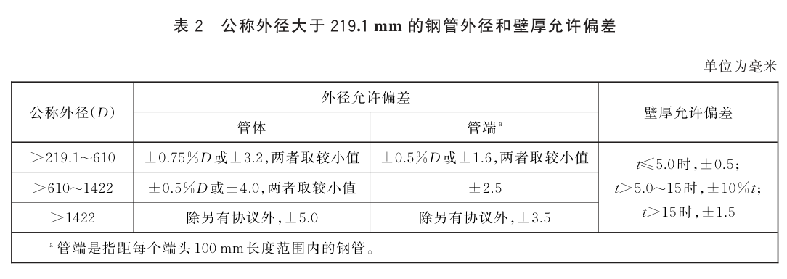

5.1.3 管端采用螺纹或沟槽连接的钢管，其公称外径和公称壁厚参见附录 A，外径和壁厚的允许偏差应符合表 1 的规定。

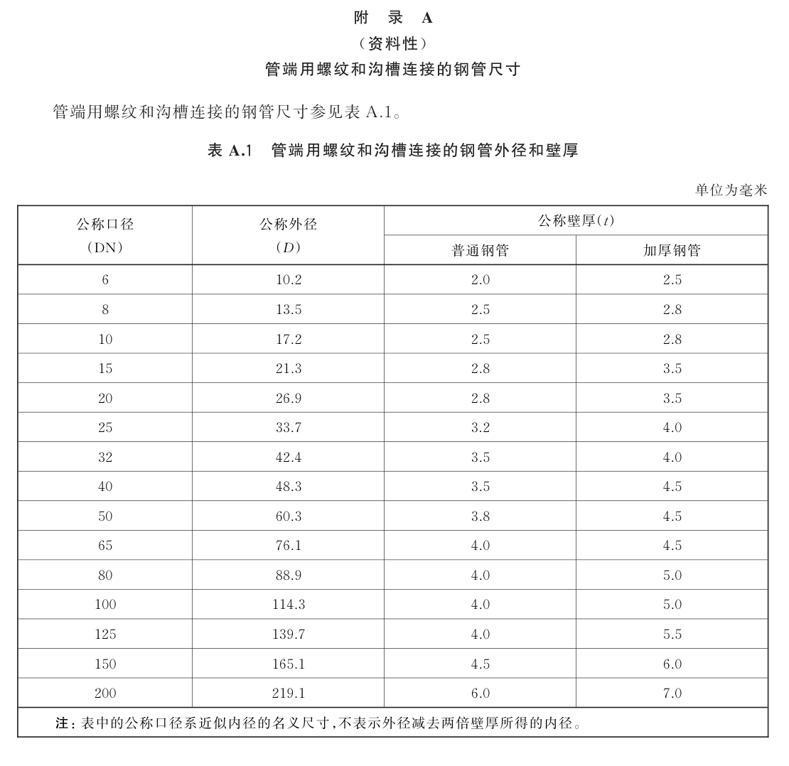

5.4.3 钢管镀锌后单位长度理论重量按公式（2）计算。

$$
W'=cW
$$

式中：
W′ —— 钢管镀锌后的单位长度理论重量，单位为千克每米（kg/m）；

c   —— 镀锌层的重量系数，分别按表 4、表 5；

W —— 钢管镀锌前的单位长度理论重量，单位为千克每米（kg/m）。

表 4 镀锌层 300 g/m2 的重量系数

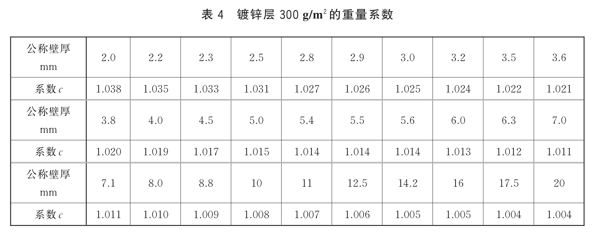

焊接钢管米重计算公式：W=0.0246615\*δ\*(D-δ) 钢材密度：7850kg/m3

### 2、工字钢、槽钢

规范：《GB/T 706-2016 热轧型钢》

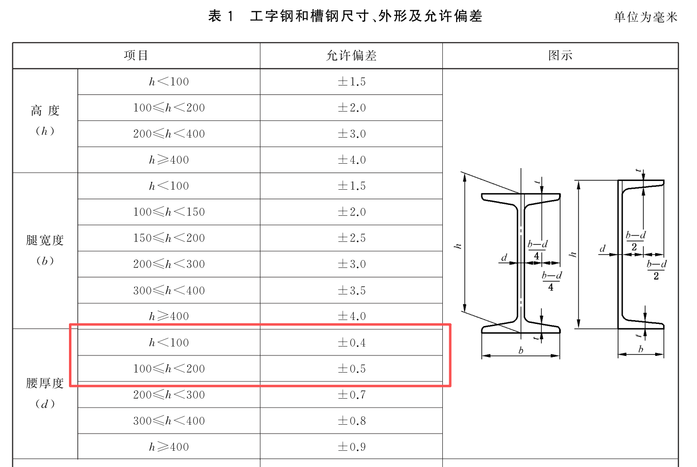

### 3、角钢

规范：《GB/T 706-2016 热轧型钢》

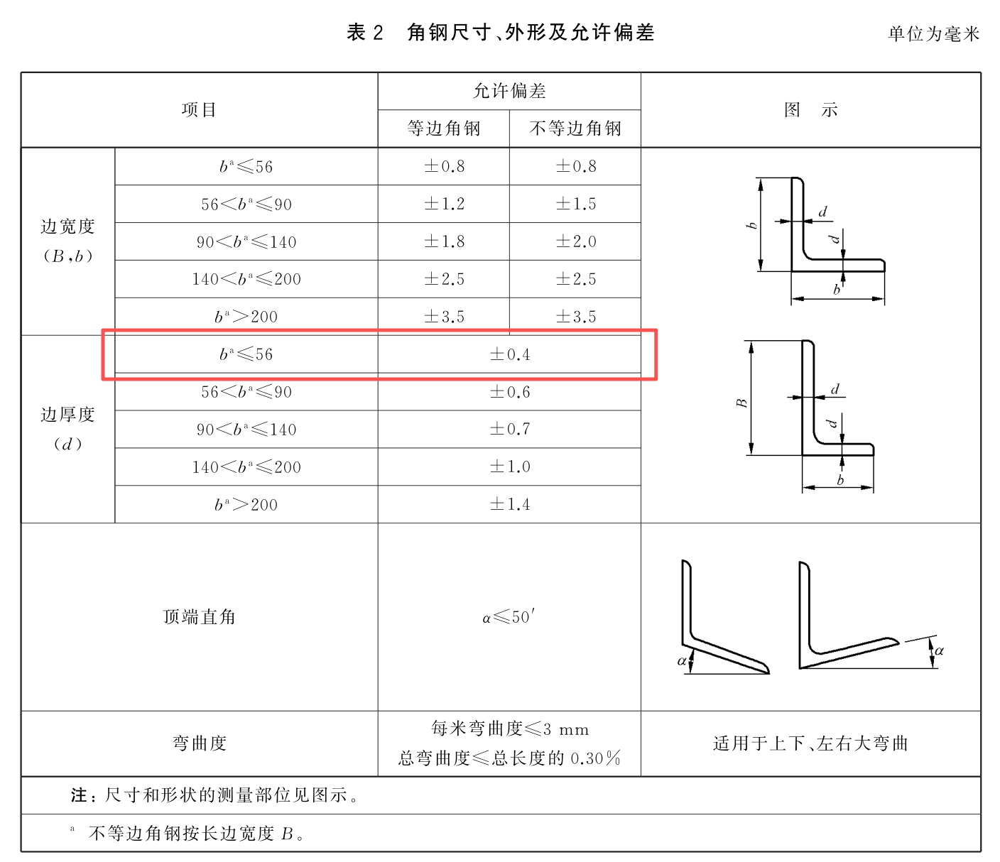

### 4、热轧扁钢

规范：《GB/T 702-2026 钢棒尺寸、外形、重量及允许偏差》

6.2.1.2 一般用途热轧扁钢的尺寸允许偏差应符合表 2 的规定。尺寸允许偏差组别可按相应产品标准执行或在订货合同中注明;产品标准或合同中未注明时，**按第 2 组允许偏差执行**。

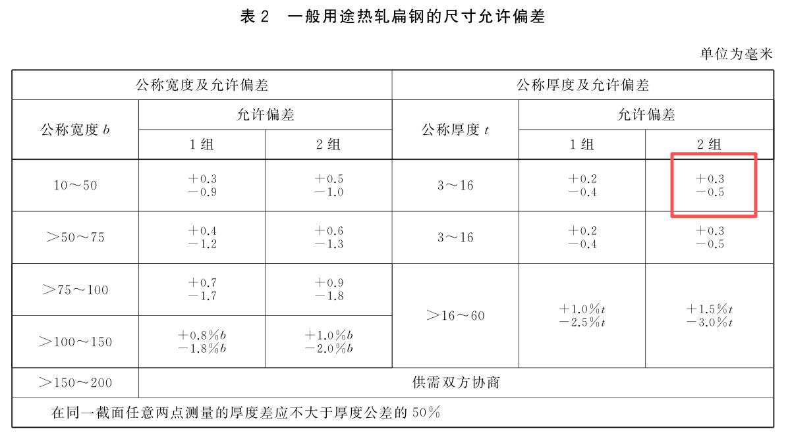

### 5、钢板

规范：《GB/T 709-2019 热轧钢板和钢带的尺寸、外形、重量及允许偏差》

定义：

> 3 术语和定义
>
> 下列术语和定义适用于本文件。
>
> 3.1 单轧钢板 plate
>
> 直接轧制、不固定边部变形的热轧扁平钢材。
>
> 3.2 宽钢带 wide strip
>
> 轧制宽度不小于 600mm 并成卷交货的钢带。
>
> 3.3 纵切钢带 slit wide strip
>
> 由宽钢带纵切而成并成卷交货得钢带。
>
> 3.4 连车钢板 plate/sheet cut from strip
>
> 由宽钢带或纵切钢带横切而成并按板状交货钢板。

允许偏差：

> 6 尺寸允许偏差
>
> 6.1 厚度允许偏差
>
> 6.1.1 单轧钢板厚度允许偏差
>
> 6.1.1.1 **单轧钢板厚度允许偏差应符合表 2(N 类) 的规定。**
>
> 6.1.1.2 根据需方要求，并在合同中注明偏差类别，可供应公差值与表 2 规定公差值相等的其他偏差类别的单轧钢板，如 A 类、B 类和 C 类偏差;也可供应公差值与表 2 规定公差值相等的限制上偏差的单轧钢板，上下偏差由供需双方协商规定。
>
> 6.1.1.3 对于厚度大于 200mm 的钢板，厚度公差也可由供需双方协商确定，并在合同中注明。
>
> 6.1.1.4 经供需双方协商，也可按照附录 A 给出的公差供货。

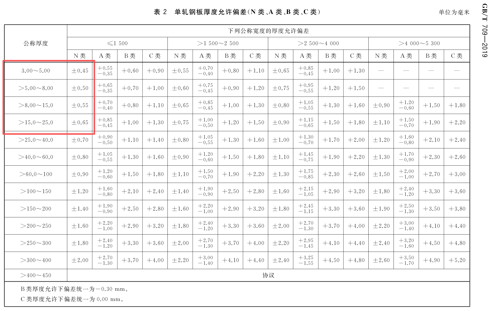

### 6、热镀锌钢板

参考武钢的热镀锌钢板，屈服强度为 275MPa，PT.A 普通精度。

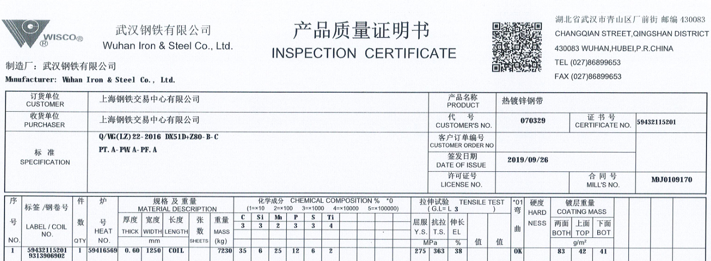

规范：《GBT 25052-2024 连续热浸镀层钢板和钢带尺寸、外形、重量及允许偏差》

> 6.1.2 规定最小屈服强度不小于 260 MPa 且小于 360 MPa 宽钢带、钢板及纵切钢带的厚度允许偏差应符合表 3 的规定。

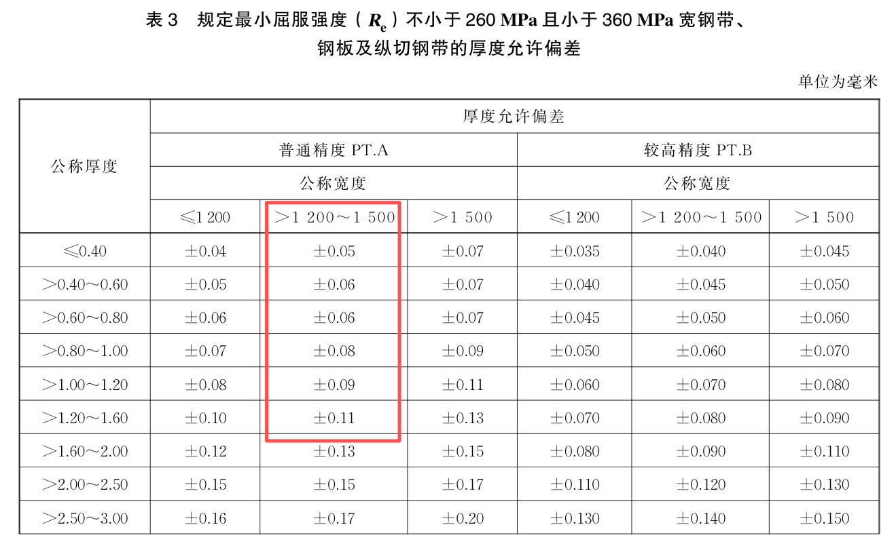

规范《JGJT 141-2017 通风管道技术规程》

> 3.1.1 金属板材风管的制作应符合下列规定：
>
> 1 普通钢板的表面应平整、光滑，厚度均匀，允许有紧密的氧化铁薄膜；不得有裂纹、结疤等缺陷，其材质应符合现行国家标准《优质碳素结构钢冷轧薄钢板和钢带》GB/T13237 或《优质碳素结构钢热轧薄钢板和钢带》GB/T710 的规定。
>
> 2 镀锌钢板 (带) 宜选用机械咬合类，其锌层厚度应符合设计或合同的规定，当无任何规定时，应采用不低于 80g/m2(Z80) 的板材，其材质应符合现行国家标准《连续热镀锌钢板及钢带》GB/T2518 的规定。
>
> 3 不锈钢板应采用奥氏体不锈钢材料，其表面不应有明显的划痕、斑痕等缺陷，材质应符合现行国家标准《不锈钢冷轧钢板和钢带》GB3280 的规定。

规范：《GB 50243-2016 通风与空调工程施工质量验收规范》

镀锌钢板风管厚度：

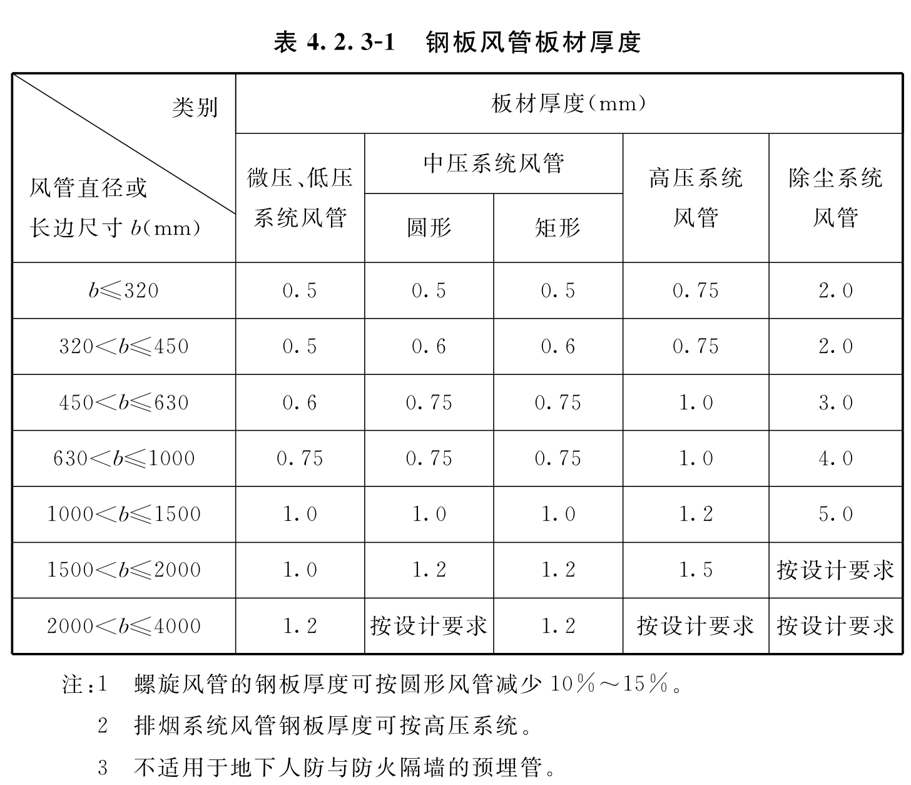

不锈钢风管厚度：

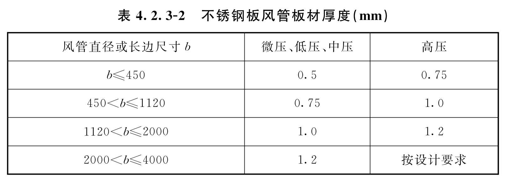

### 7、PVC-U 管

规范：《GBT 5836.1-2018 建筑排水用硬聚氯乙烯（PVC-U）管材》

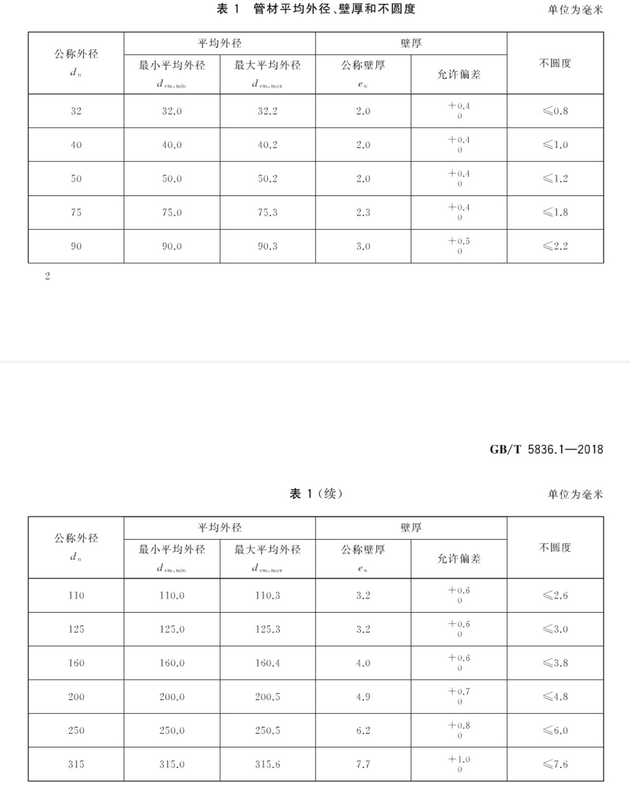

### 8、PPR 管

规范：《GBT 18742.2-2017 冷热水用聚丙烯管道系统 第 2 部分：管材》

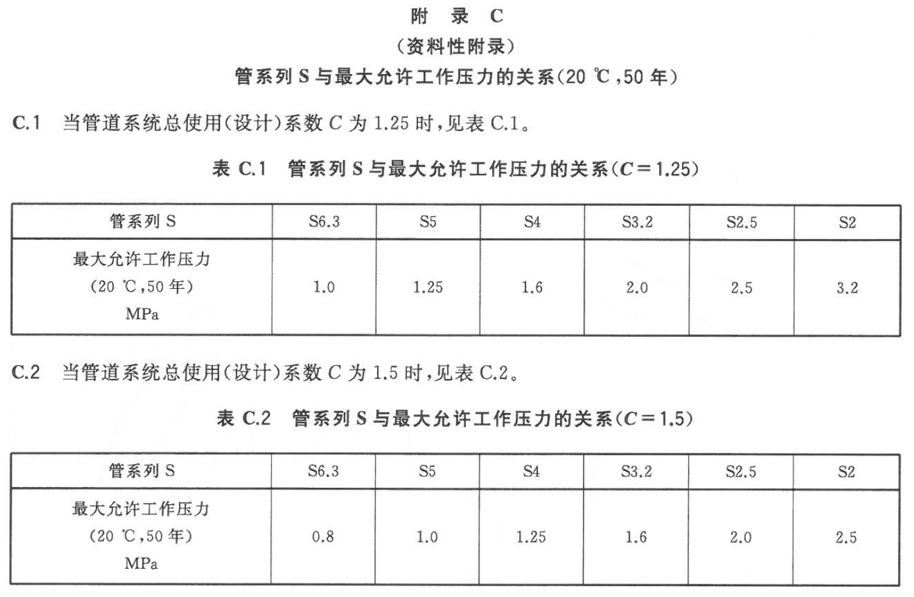

管系列 S 的选择：

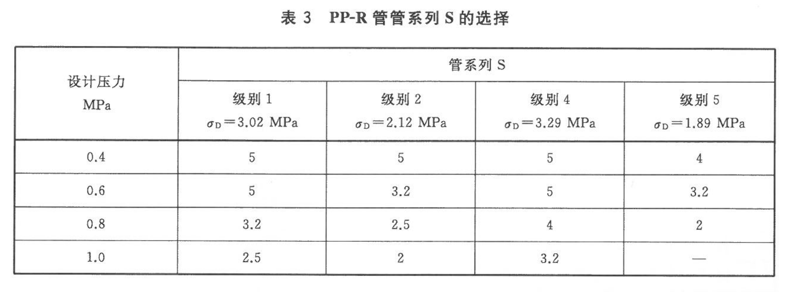

> 技术要求：
>
> 7 要求
>
> 7.1 颜色
>
> 一般为灰色，其他颜色可由供需双方协商确定。
>
> 7.2 外观
>
> 管材表面颜色应均匀一致，不应有明显色差。
>
> 管材的内外表面应光滑、平整，不应有凹陷、气泡、杂质和其他影响产品性能的表面缺陷。管材端面应切割平整并与轴线垂直。
>
> 7.3 规格及尺寸
>
> 7.3.1 管材规格用管系列 S、公称外径 dnX 公称壁厚 en 表示。
>
> 示例：管系列 S5、公称外径为 32mm、公称壁厚为 2.9mm 表示为 S5 dn32Xe~n~2.9
>
> 7.3.2 管材的公称外径、平均外径以及管系列 S 对应的最小壁厚 (不包括阻隔层和黏接层的壁厚),见表 5。阻隔层和黏接层总壁厚应不大于 0.4mm。

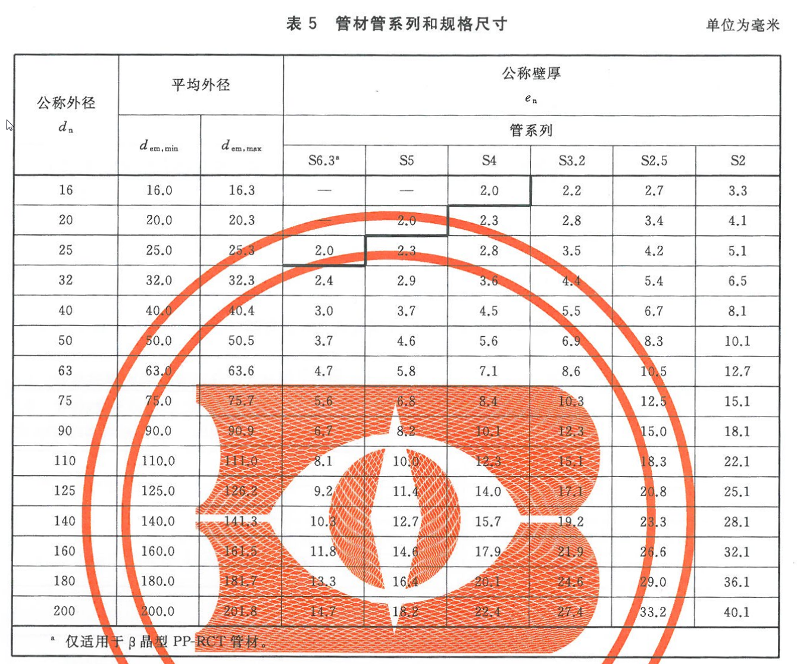

壁厚偏差：

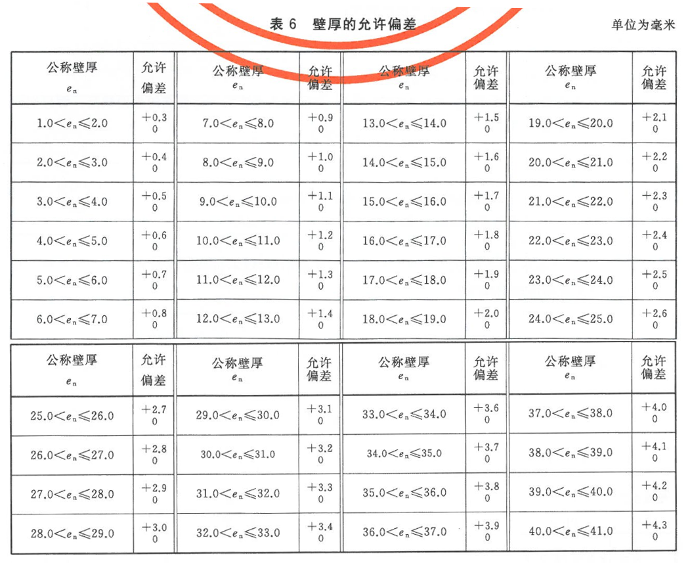

### 9、PB 管

规范：《GB/T 19473.2-2020 冷热水用聚丁烯 (PB) 管道系统 第 2 部分管材》

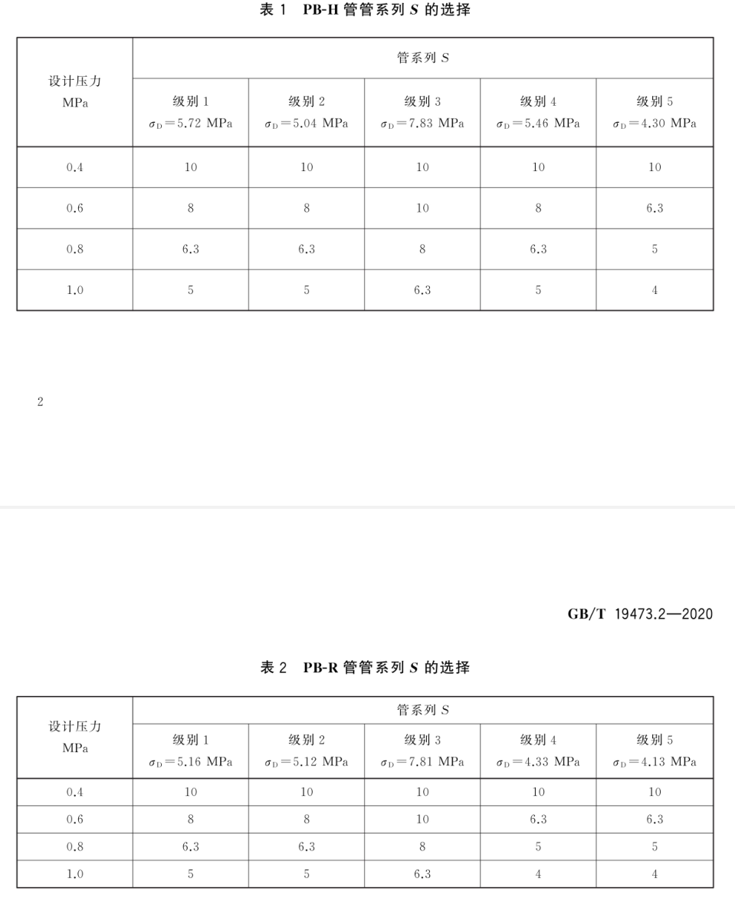

管材规格尺寸：

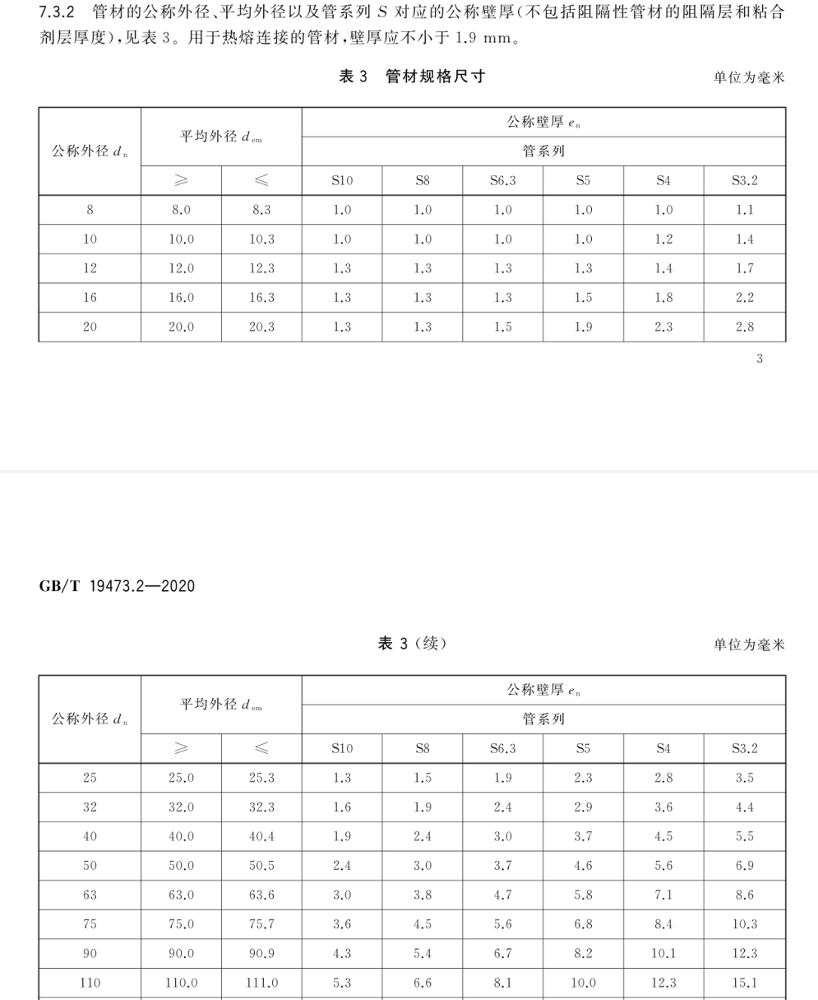

管材允许壁厚偏差：

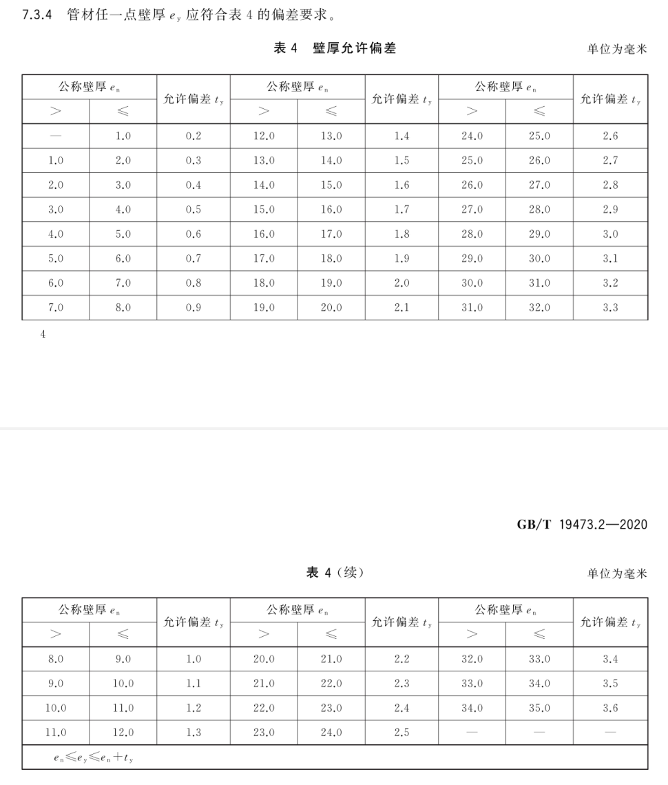

### 10、铸铁管

规范：《GB/T 12772-2016 排水用柔性接口铸铁管、管件及附件》

| 公称直径  | 外径 DE/mm | 壁厚 T/mm（A 型 A 级） | 壁厚 T/mm（B 型） | 壁厚 T/mm（W 型） | 允许壁厚偏差/mm（A、B、W 型） |
|:-----:|:--------:|:----------------:|:------------:|:------------:|:------------------:|
| DN50  | 61       | 4.5              | 4.5          | 4.3          | -0.7               |
| DN75  | 86       | 5.0              | 4.5          | 4.4          | -0.7               |
| DN100 | 111      | 5.0              | 5.0          | 4.8          | -0.7               |
| DN125 | 137      | 5.5              | 5.0          | 4.8          | -0.7               |
| DN150 | 162      | 5.5              | 5.0          | 4.8          | -0.7               |
| DN200 | 214      | 6.0              | 6.0          | 5.8          | -1.0               |
| DN250 | 268      | 7.0              | 7.0          | 6.4          | -1.2               |
| DN300 | 318      | 7.0              | 7.0          | 7.0          | -1.2               |
