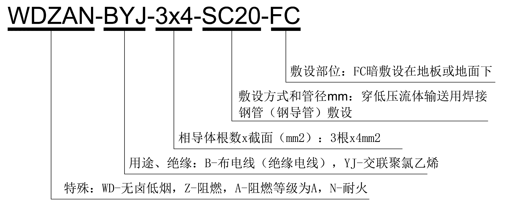
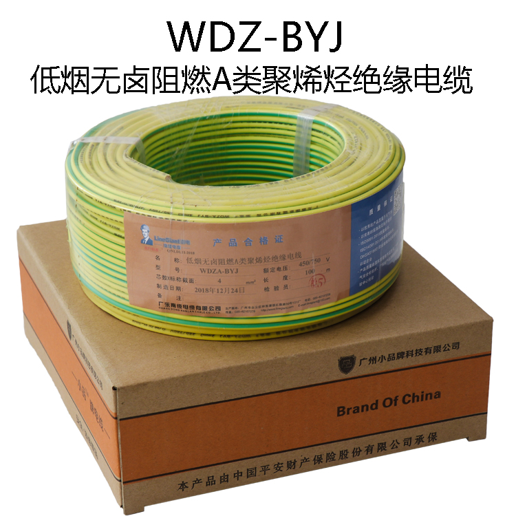
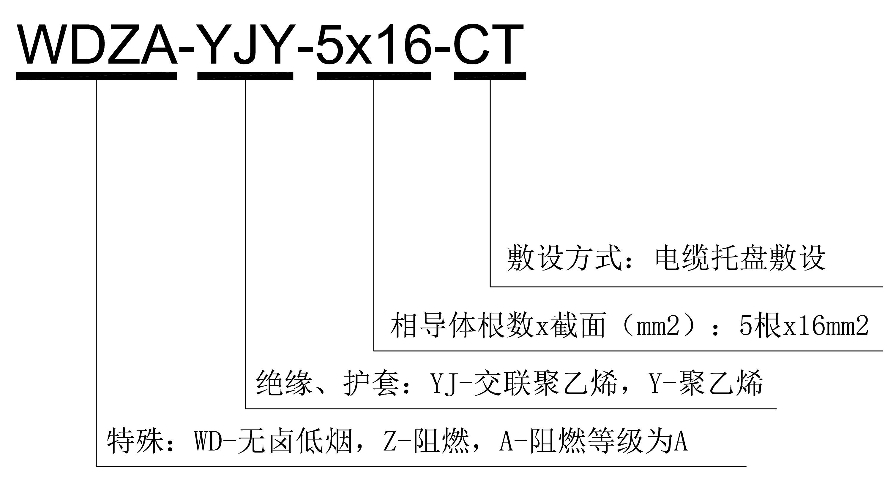
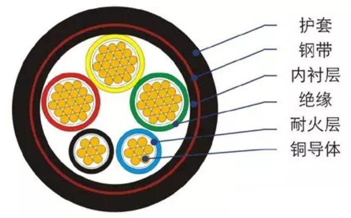

# 电线电缆

## 定义

广义的电线电缆亦简称为电缆。狭义的电缆是指绝缘电缆。它可定义为：由下列部分组成的集合体，一根或多根绝缘线芯，以及它们各自可能具有的包覆层，总保护层及外护层。电缆亦可有附加的没有绝缘的导体。

我国的电线电缆产品按其用途分成下列五大类：

1.裸电线；

2.绕组线；

3.电力电缆；

4.通信电缆和通信光缆；

5.电气装备用电线电缆。

电线电缆的基本结构：

1.导体：传导电流的物体，电线电缆的规格都以导体的截面表示。

2.绝缘：外层绝缘材料按其耐受电压程度。

## 规范

本节用到的标准分两类：电缆型号与产品标准，以及建筑电气敷设符号标准。

电缆产品依据 **GB/T 5023.1-2008**《额定电压 450/750V 及以下聚氯乙烯绝缘电缆 第 1 部分：一般要求》[^1]。

线缆敷设方式与敷设部位符号依据 **GB/T 50786-2012**《建筑电气制图标准》表 4.2.1[^2]。

## 电线（布电线）型号示例

布电线按"燃烧特性—用途/绝缘—规格—敷设方式—敷设部位"的顺序构成型号。以下为低烟无卤阻燃耐火类布电线的实例拆解（图见 `img`）。

**示例 ①：WDZAN-BYJ-3x4-SC20-FC**

| 段 | 代号 | 含义 |
|:---|:---|:---|
| 燃烧特性 | WD | 无卤、低烟 |
| 燃烧特性 | Z | 阻燃 |
| 燃烧特性 | A | 阻燃等级为 A 级 |
| 燃烧特性 | N | 耐火 |
| 用途/绝缘 | B | 布电线（绝缘电线） |
| 用途/绝缘 | YJ | 交联聚乙烯绝缘 |
| 规格 | 3x4 | 3 根，4 mm² |
| 敷设方式 | SC20 | 穿低压流体输送用焊接钢管（钢导管），管径 20 mm |
| 敷设部位 | FC | 暗敷设在地板或地面下 |

**示例 ②：WDZA-BYJ**

## 电力电缆型号示例

电力电缆型号同样按"燃烧特性—绝缘/护套—规格—敷设方式"构成。以下为无卤低烟阻燃 A 级交联聚乙烯绝缘电力电缆的实例拆解。

**示例：WDZA-YJY-5x16-CT**

| 段 | 代号 | 含义 |
|:---|:---|:---|
| 燃烧特性 | WD | 无卤、低烟 |
| 燃烧特性 | Z | 阻燃 |
| 燃烧特性 | A | 阻燃等级为 A 级 |
| 绝缘/护套 | YJ | 交联聚乙烯绝缘 |
| 绝缘/护套 | Y | 聚乙烯（护套） |
| 规格 | 5x16 | 5 根，16 mm² |
| 敷设方式 | CT | 电缆托盘敷设 |

电缆的典型结构见下图（自内向外：铜导体→耐火层（如有）→绝缘→内衬层→钢带（如有）→护套）。

### 线缆敷设方式

依据 GB/T 50786-2012 表 4.2.1-1[^2]。

| 符号 |                  名称                  |          英文名称           |
| :--: | :------------------------------------: | :-------------------------: |
|  SC  | 穿低压流体输送用焊接钢管（钢导管）敷设 | Run in welded steel conduit |
|  CT  |              电缆托盘敷设              |   Installed in cable tray   |
|  CL  |              电缆梯架敷设              |  Installed in cable ladder  |

### 线缆敷设部位

依据 GB/T 50786-2012 表 4.2.1-2[^2]。

| 符号 |         名称         |           英文名称            |
| :--: | :------------------: | :---------------------------: |
|  CE  |   沿吊顶或顶板面敷   | Along ceiling or slab surface |
|  CC  |     敷设在顶板内     | Concealed in ceiling or slab  |
|  WC  |     暗敷设在墙内     |       Concealed in wall       |
|  FC  | 暗敷设在地板或地面下 |      In floor or ground       |

## 参考文献

[^1]: GB/T 5023.1-2008 额定电压 450/750V 及以下聚氯乙烯绝缘电缆 第 1 部分：一般要求[S]. <https://openstd.samr.gov.cn/bzgk/std/newGbInfo?hcno=A39DEB97A41AA38BDDD42D343010870D>.

[^2]: GB/T 50786-2012 建筑电气制图标准[S]. <https://www.gongbiaoku.com/book/6f4178337av>.
