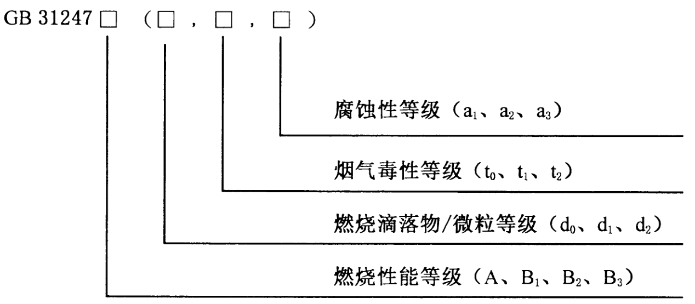

# 电线电缆阻燃、燃烧等级

电线电缆的阻燃与燃烧性能有两种标识体系，依据的标准不同，分级方法与评价参数也不同，工程中如不加辨析极易混用误标。

> 参考文章：<https://zhuanlan.zhihu.com/p/362329082>、<https://mp.weixin.qq.com/s/ULtKgO_TuDGzQiD7FJ176g>；建筑电气杂志 2018 年第 9 期 李燕《如何正确选择阻燃电缆级别》。

## 常见问题

现实中很多厂家会在电线标注 `WDZB1-BYJ`，**这种标注是错误的**——它把两套体系的代号混写在一起：`WDZB` 属于 GB/T 19666 的无卤低烟阻燃体系（B 级），而 `B1` 属于 GB 31247 的燃烧性能分级体系，二者不能直接拼接。

## 方法一：GB/T 19666 阻燃性能标识（A/B/C/D）

依据《GB/T 19666-2019 阻燃和耐火电线电缆或光缆通则》[^1]。阻燃电缆在原型号前增加阻燃代号，阻燃类别分为 **A、B、C、D 四个等级**（代号 ZA、ZB、ZC、ZD），与无卤低烟（WDZ）等燃烧特性组合。

例如：`WDZA-YJY-8.7/10 3×240`，表示无卤低烟、阻燃 A 级、交联聚乙烯（XLPE）绝缘、聚烯烃护套、额定电压 8.7/10 kV、3×240 mm² 电缆。

> ⚠️ 注意：无卤低烟（WDZ）电缆的护套应为**聚烯烃**等无卤材料，型号为 `YJY`。若写成 `YJV`，其护套为聚氯乙烯（PVC），含卤，与“无卤低烟”矛盾，故不存在 `WDZA-YJV` 这一合规型号（这正是市面乱标的原因之一）。

阻燃 A 类测试方法依据《GB/T 18380.33-2022 电缆和光缆在火焰条件下的燃烧试验 第 33 部分：垂直安装的成束电线电缆火焰垂直蔓延试验 A 类》[^3]。

## 方法二：GB 31247 燃烧性能分级（A/B1/B2/B3）

依据《GB 31247-2014 电缆及光缆燃烧性能分级》[^2]。

例如：`GB31247 B1（d0,t1,a1）` 表示电缆或光缆的燃烧性能等级为 **B1 级**，燃烧滴落物/微粒等级为 **d0 级**，烟气毒性等级为 **t1 级**，腐蚀性等级为 **a1 级**。

## 两套体系对比

| 项目         | 方法一（GB/T 19666）                 | 方法二（GB 31247）                                  |
|:------------ |:------------------------------------ |:--------------------------------------------------- |
| 分级         | 阻燃 A、B、C、D 级（代号 ZA~ZD）     | 燃烧性能 A、B1、B2、B3 级                           |
| 参考国际标准 | IEC 60332（国际电工委员会）          | EN 50399:2011（欧盟）                               |
| 主要评价参数 | 火焰蔓延高度（炭化高度）             | 火焰蔓延 + 热释放、产烟特性、滴落物、烟毒、腐蚀性等 |
| 判定层面     | 单参数达标                           | 多参数综合分级                                      |
| 标识构成     | 燃烧特性代号（无卤低烟等）+ 阻燃等级 | 燃烧等级 + 附加信息（d0/t1/a1）                     |

> IEC 即国际电工委员会（International Electrotechnical Commission），和欧盟是两个不同的组织，检测、评定方法均不同。

## 选型规定

方法二不仅考核火焰蔓延高度（炭化高度），还考核电缆的热释放、产烟特性等参数，更能客观反映火灾现场情况以及对周围环境的影响。

需要说明的是：**GB 31247 仅提供分级体系与试验方法，本身不规定“哪些建筑选哪级”**。对各类民用建筑及场所线缆燃烧性能的选型规定，出自《GB 51348-2019 民用建筑电气设计标准》第 13 章[^4]，其中引用了 GB 31247 的分级体系（如 B1（d0,t1,a1）等）分别对应不同场所。

因此合理的做法是：以 GB 51348 确定建筑场所对应的燃烧性能等级，再按 GB 31247 选定满足该等级的电缆型号。

## 参考文献

[^1]: GB/T 19666-2019 阻燃和耐火电线电缆或光缆通则[S/OL]. <https://openstd.samr.gov.cn/bzgk/std/newGbInfo?hcno=94C99AEBBAA3DA1AC549915623DC3264>.

[^2]: GB 31247-2014 电缆及光缆燃烧性能分级[S/OL]. <https://openstd.samr.gov.cn/bzgk/std/newGbInfo?hcno=65DE2157A434B973AEC5553C95824447>.

[^3]: GB/T 18380.33-2022 电缆和光缆在火焰条件下的燃烧试验 第 33 部分：垂直安装的成束电线电缆火焰垂直蔓延试验 A 类[S/OL]. <https://openstd.samr.gov.cn/bzgk/std/newGbInfo?hcno=DDBFF8DA60E13C7FBEFAD48A19323B22>.

[^4]: GB 51348-2019 民用建筑电气设计标准[S].
